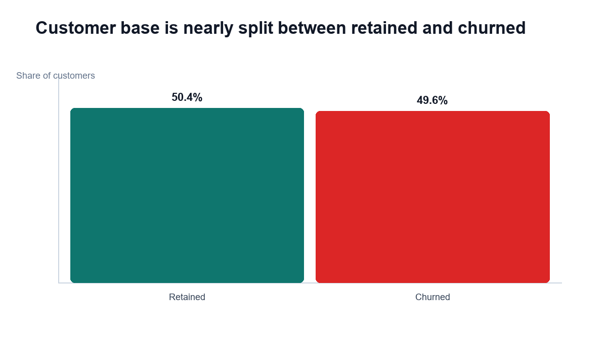
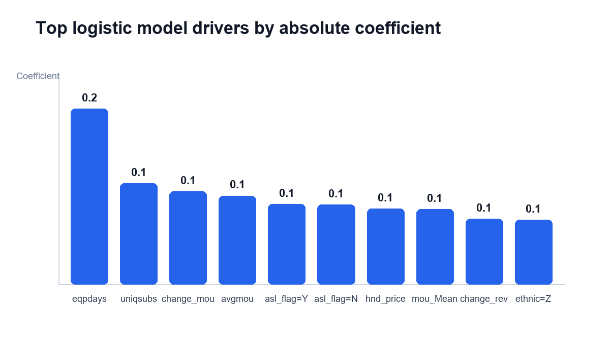
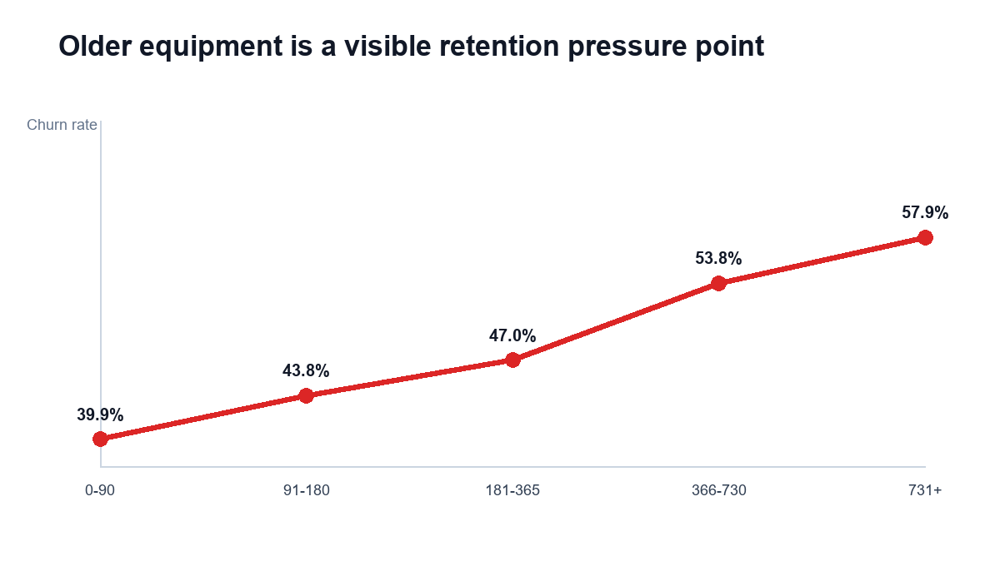
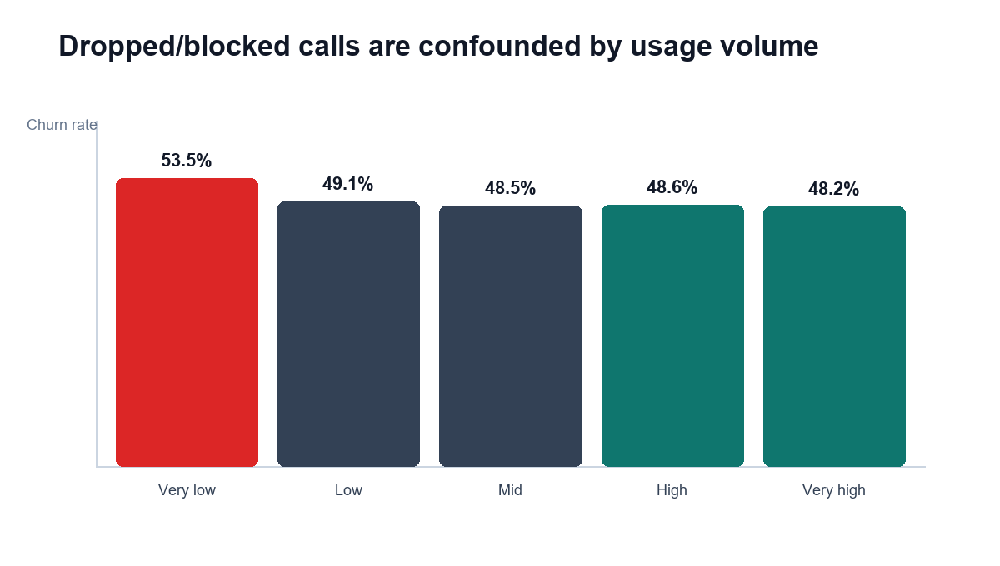
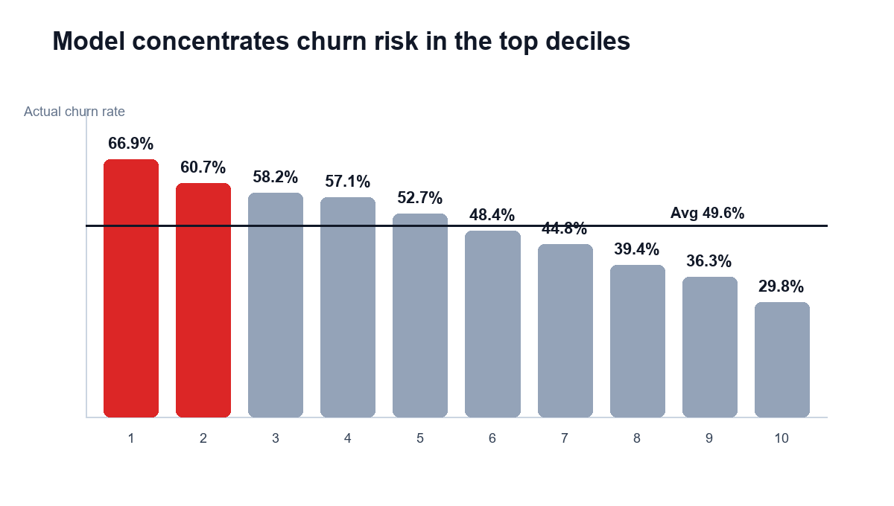

# 📡 Telecom Customer Churn Prediction & Business Strategy (PoC)

[](https://www.python.org/)
[](https://scikit-learn.org/)
[](https://pandas.pydata.org/)
[](LICENSE)
[](#-machine-learning-performance)
[](#-financial-roi--business-impact)

> An **end-to-end Machine Learning pipeline & Proof of Concept (PoC) Business Proposal** developed for a major telecommunications provider ("Company A") to analyze customer retention, build predictive churn models on **100,000+ customer records**, and construct a high-ROI targeted retention campaign.
> 
> *Developed as part of the **Global AI Course (GCI World 2026 Spring)** by **Matsuo-Iwasawa Laboratory, The University of Tokyo**.*

---

## 📌 Executive Summary

Customer churn is the single largest driver of revenue loss in the telecommunications industry. In this project, we analyzed historical behavioral, transactional, and service data from **100,000 telecom subscribers across 100 features** to identify the key friction points driving customer departure and build an automated risk-scoring model.

### Key Highlights:
- **Baseline Churn Rate:** **49.56%** of subscribers churn, putting **~$2.87M in monthly revenue at risk**.
- **Predictive Modeling:** Developed an $L_2$-regularized Logistic Regression classifier achieving an **ROC-AUC of 0.628** on unseen holdout test data.
- **Risk Decile Targeting:** The top **20% highest-risk customers** capture **25.8% of all churners** (a **1.29x lift** over random targeting).
- **Financial Business Impact:** Proposed a targeted retention campaign with an estimated **net gross margin impact of +$554,600** and an **ROI multiple of 2.77x** ($2.77 returned per $1 invested).

---

## 📊 Visual Insights & Exploratory Data Analysis (EDA)

| Baseline Churn Distribution | Key Churn Drivers (Feature Importance) |
| :---: | :---: |
|  |  |

| Equipment Age vs. Churn Risk | Customer Care Inquiries vs. Churn |
| :---: | :---: |
|  |  |

### 🔍 Key Business Findings:
1. **Equipment Obsolescence:** Subscribers with equipment older than 365 days exhibit significantly higher churn rates. Device upgrades act as a major anchor for customer retention.
2. **Support Contact Frequency:** High contact frequency with Customer Care correlates with lower churn when issues are resolved promptly, whereas unaddressed network/billing issues trigger departure.
3. **Usage Volume Drops:** Sharp declines in monthly minutes of use (MOU) and data traffic serve as leading indicators of imminent subscriber churn.

---

## 🤖 Machine Learning Performance

We trained and validated an $L_2$-regularized Logistic Regression pipeline with class-weight balancing on a 75/25 train-test split (24,965 test samples).

### Model Evaluation Metrics:

| Metric | Holdout Score | Description |
| :--- | :---: | :--- |
| **ROC-AUC** | **0.6283** | Primary metric evaluating rank-ordering capacity across all probability thresholds. |
| **PR-AUC** | **0.5997** | Precision-Recall curve area, measuring positive class prediction trade-offs. |
| **Accuracy** | **59.66%** | Classification accuracy at standard 0.5 decision threshold. |
| **Precision** | **59.03%** | Proportion of predicted churners who actually churned. |
| **Recall** | **60.13%** | Proportion of actual churners correctly identified by the model. |
| **F1-Score** | **0.5957** | Harmonic mean of Precision and Recall. |

### Cumulative Gain & Decile Analysis:



*By scoring the customer base into deciles based on predicted churn risk, marketing teams can deploy surgical retention offers to the top 20%–30% risk tiers rather than blasting the entire base.*

---

## 💰 Financial ROI & Business Impact

We constructed a realistic financial campaign simulation to evaluate the business impact of targeting the top 20,000 highest-risk subscribers:

```
+-----------------------------------------------------------------------+
|                       RETENTION CAMPAIGN ROI                          |
+-----------------------------------------------------------------------+
|  Total Monthly Revenue at Risk          :  $2,870,795                 |
|  Targeted Campaign Audience            :  20,000 high-risk users      |
|  Assumed Offer Cost per Target         :  $10.00                      |
|  Total Campaign Investment             :  $200,000                    |
|  Expected Saved Customers (15% Save)   :  1,913 subscribers           |
|  Gross Margin Saved (12 Months @ 55%)  :  $754,599                    |
|  ------------------------------------------------------------------   |
|  NET FINANCIAL GAIN                    :  +$554,600                   |
|  CAMPAIGN ROI MULTIPLE                 :  2.77x (277% Return)         |
+-----------------------------------------------------------------------+
```

---

## 📁 Repository Structure

```
.
├── README.md                              # Main documentation & executive overview
├── LICENSE                                # MIT License
├── requirements.txt                       # Dependencies
├── .gitignore                             # Git ignore configuration
├── docs/
│   └── GCI_Telecom_Churn_Proposal.pdf     # 15-Slide Executive Presentation PDF
├── notebooks/
│   └── GCI_Telecom_Churn_Analysis.ipynb   # Executable Jupyter Notebook
├── src/
│   ├── gci_telecom_churn_analysis.py      # Core Data Pipeline & Modeling Script
│   ├── build_gci_final_deliverables.py    # Report & Deliverable Generator
│   └── build_polished_gci_pdf.py          # ReportLab PDF Generator Script
├── charts/                                # Generated high-resolution visuals
│   ├── churn_rate.png
│   ├── feature_importance.png
│   ├── equipment_age_churn.png
│   ├── service_issue_churn.png
│   ├── usage_churn.png
│   └── model_gain_deciles.png
└── data_outputs/                          # Analysis & Model Scoring Artifacts
    ├── analysis_summary.json
    ├── logistic_coefficients.csv
    ├── model_gain_deciles.csv
    └── sample_scored_customers.csv
```

---

## 🚀 Quickstart & Reproduction

### 1. Clone the Repository
```bash
git clone https://github.com/0xsabry/telecom-customer-churn-poc.git
cd telecom-customer-churn-poc
```

### 2. Install Dependencies
```bash
pip install -r requirements.txt
```

### 3. Run the End-to-End Analysis Pipeline
```bash
python src/gci_telecom_churn_analysis.py
```

### 4. Rebuild PDF Presentation & Deliverables
```bash
python src/build_polished_gci_pdf.py
```

---

## 📄 Executive Deliverables

- 📊 **Executive Presentation Slides (PDF):** [`docs/GCI_Telecom_Churn_Proposal.pdf`](docs/GCI_Telecom_Churn_Proposal.pdf)
- 📓 **Jupyter Notebook:** [`notebooks/GCI_Telecom_Churn_Analysis.ipynb`](notebooks/GCI_Telecom_Churn_Analysis.ipynb)

---

## 👤 Author & Acknowledgments

**Mohamed Sabry Hamdan**  
*SOC Analyst | Security Engineer | Data & ML Specialist*  
- **GitHub:** [@0xsabry](https://github.com/0xsabry)  
- **LinkedIn:** [Mohamed Sabry](https://www.linkedin.com/in/mohamedsabry01/)  

*Course Acknowledgments: **Global AI Course (GCI World 2026 Spring)** conducted by **Matsuo-Iwasawa Laboratory, The University of Tokyo**.*

---

## 📜 License
This project is licensed under the [MIT License](LICENSE).
